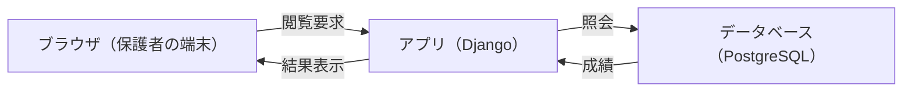
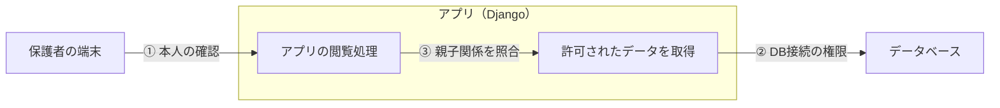
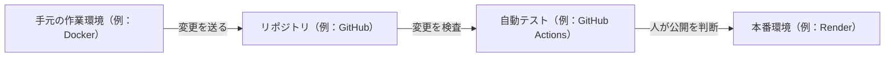
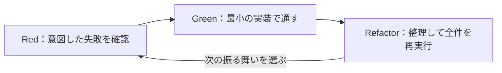

# TDDとセキュリティを組み込む開発手順書

新規開発にも既存機能の改修にも使える、8工程の手順です。最初に「誰が何をできればよいか」と「何が起きると困るか」を決めます。そこから、小さな単位でテスト・実装・確認を繰り返します。

| 工程 | 最初に考える問い | この工程で残すもの |
| --- | --- | --- |
| [01　要件](#requirements) | 誰が、何をできれば成功か？ | 受入条件と扱うデータ |
| [02　構成](#architecture) | どこで動き、データはどこへ行くか？ | 構成図と技術を選んだ理由 |
| [03　脅威](#threats) | どの受け渡しで、何が起きると困るか？ | 境界ごとの脅威・影響・対策 |
| [04　優先順位](#backlog) | 試用や本番利用の前に何を確かめるか？ | 優先順をつけた作業一覧 |
| [05　開発準備](#setup) | どこで試し、誰が変更を取り込むか？ | 再現できる環境と作業ルール |
| [06　TDD](#tdd) | 期待した理由でテストが失敗し、実装後に通るか？ | テスト・実装・実行結果 |
| [07　リリース](#release) | この版を、誰がどの範囲で使ってよいか？ | 利用開始の判断と戻し方 |
| [08　運用](#operations) | 異常にどう気づき、次の変更に何を生かすか？ | 対応記録と次の作業項目 |

### 開発するときの使い方

新しい案件では、巻末の「案件ごとの記入シート」を複製します。小さな改修なら、変更で影響する要件・境界・テストを既存の記録に追記します。工程06は、作業項目を一つ選ぶたびに繰り返します。

通し例は講義の成績閲覧アプリです。集計ツール・定期処理・ライブラリへの応用は「開発の種類に応じた読み替え」にまとめました。

### 毎回の開発で参照するには

Markdown版を docs/開発手順書.md に置き、既存のAGENTS.mdに次の一文を追記できます。

> 着手時は docs/開発手順書.md を読み、作業項目・現在の工程・次に確かめる受入条件を示す。

## 工程 01・02　要件を一文にして構成図を描く

要件がすでにある場合は、代表的な操作を一つ選び、成功と失敗を判定できるか確認します。その操作から図を描くと、必要な構成を絞れます。

### 01　誰が何をできればよいか

「利用者」「操作」「対象データ」「成功時と、入力不備や権限不足のときの結果」を書きます。利用者は人のほか、定期実行するプログラムでも構いません。受入条件とは、使う人が「これでよい」と判断できる具体的な振る舞いです。

| 成績閲覧の例 | 受入条件 |
| --- | --- |
| 保護者Aが自分の子の成績を見る | 紐づく子の成績と推移を表示する。 |
| 保護者Aが別の家庭の子の成績を求める | その子の成績を返さない。 |
| ログインせずに成績を求める | 成績を返さず、ログインを求める。 |

### 02　どこで何が動くか

入力元・処理・保存先を描き、矢印に「何が渡るか」を書きます。候補の技術は費用、保守する人の経験、既存システムとの連携で比較し、採用理由を一行残します。講義例はDjangoとPostgreSQLで、公開先の候補がRenderでした。

関係者間の引き継ぎが複雑なら、担当者ごとに列を分けた業務フロー図を先に描きます。構成図には端末・サービスとデータの流れを残します。

**完了の目安**　代表操作の期待結果と、その操作でデータが通る経路を説明できる。

## 工程 03　データの受け渡しから脅威を見つける

工程02の構成図を複製し、相手やデータの扱いが変わる場所に印をつけます。これが信頼境界です。誰が設定・監視・復旧を担うかという責任分担も、別に書き添えます。

### 境界ごとに一つずつ問いを立てる

| 確認する場所 | 起きると困ること | 設計に入れる対策の例 |
| --- | --- | --- |
| ① 端末からアプリへ | 未ログインの利用者に成績が返る。 | サーバーがセッションの有効性を確認する。 |
| ② アプリからDBへ | 閲覧処理の誤りで、成績まで変更される。 | DB接続に与える権限を用途に必要な範囲に絞る。 |
| ③ アプリ内の権限 | ログイン済みの保護者に、別の子の成績が返る。 | 対象の子との親子関係をサーバーで照合する。 |

①は「誰として利用中か」を確かめる認証、③は「その人にこの記録を見せてよいか」を確かめる認可です。ログイン後も対象ごとに権限を確かめます。これは講義で扱ったゼロトラストの具体例です。管理者の重要操作には、追加の本人確認として多要素認証を検討します。

### 見落としを探す

「漏れる・書き換わる・止まると誰が困るか」から始めます。STRIDEを使うと、なりすまし、改ざん、否認（後から操作を追えない）、情報漏えい、サービス拒否、権限昇格の6方向から見直せます。外部APIや生成AIを使う場合は、送る項目と認証情報の保管場所も図に加えます。

**完了の目安**　影響の大きい脅威について、困る人、対策の場所、担当を特定できる。

## 工程 04　利用開始前に必要な仕事を決める

起こりやすさと被害の大きさでリスクを見積もります。次に、利用者数・データの種類・期限・対応コストを踏まえ、どの段階までに対処するかを責任者が決めます。

### 使い始める段階に合わせて線を引く

講義に登場した区切りの例は、P0が「実データで試す前」、P1が「本番公開前」です。本書も例ではこの呼び方を使います。各案件では「自分だけで試す」「職員が試用する」「全員が使う」など、実際の使い始めに合わせて定義します。

| 作業項目の例 | 受入条件・確認方法 | 期限の判断例 |
| --- | --- | --- |
| A01　保護者が子の成績を見る | 自分の子は表示。別の子と未ログインの要求には成績を返さない。T1〜T3で確認。 | P0。試用でも他の家庭の成績が漏れるため。 |
| A02　不審なログインを担当者に知らせる | 合意した条件でテスト通知が届き、担当者が対象時刻を確認できる。 | P1。公開時から対応者が異常に気づけるようにする。 |
| A03　成績の推移をグラフでも見る | 既存の数値一覧と同じ値が表示される。 | 公開後。初回は数値一覧で推移を確認できる。 |

### 機能と対策を同じ作業一覧に載せる

この一覧をバックログと呼びます。AIに候補を出してもらったら、抜けや過剰な対策を人が見直します。A01なら「閲覧画面」と「別の子の成績を返さないこと」を一緒に完了させます。未対応を残すときは、影響・当面の対応・担当・再確認日を記録します。受け入れられないリスクが残る場合は、利用範囲を狭めるか、公開を保留します。

**完了の目安**　今回の対象と見送り項目を区別でき、最初に実装する一件とその合格条件が決まっている。

## 工程 05　安全に変更を試せる場所を用意する

テストを書く前に、普段の作業場所、使うデータ、変更が本番へ届く経路を確認します。AIと一緒に作業する場合は、AIが触れる範囲もここで決めます。

### 手元と自動テストの条件を合わせる

架空のデータで、起動・テスト・初期状態への戻し方を確かめます。Dockerを使うなら、アプリとDBを同じ設定で起動できるようにします。CI（継続的インテグレーション）を使う場合は、手元と同じテストを変更ごとに実行し、結果を残します。

### AIに任せる作業と、人が決めること

| 仕組み | この例で用意するもの |
| --- | --- |
| ハーネス | AIが作業し、結果を確かめる仕組み。作業ブランチ、架空データ、テストの実行方法を用意する。 |
| ガードレール | 操作の制限。作業用の権限を絞り、共有ブランチへの直接変更、本番接続、未承認の外部送信を制御する。 |
| フック・変更の検知 | 特定の操作をきっかけにチェックする。ルールやフック自体の変更もレビュー対象にし、担当者に通知する。 |

作業ルールはリポジトリに書き、共有ブランチの保護やアクセス権でも支えます。開発時の「ルール変更通知」と、運用時の「不審ログイン通知」は、受け取った人が取る行動も別々に決めます。

**完了の目安**　本番に影響せずにテストを実行でき、重要な設定の変更を誰が確認するか決まっている。

## 工程 06　テストを先に書いて小さく実装する

テスト駆動開発（TDD）は、作業項目を一つ選んで、期待する振る舞いを先にテストで表す方法です。ここでは工程04のA01を、架空の2家庭で確かめます。

| A01のテスト | 前提と操作 | 期待結果 |
| --- | --- | --- |
| T1　許可 | 保護者Aがログインし、自分の子Aの成績を開く。 | 子Aの成績と推移を返す。 |
| T2　対象外 | 同じ保護者Aが、別家庭の子Bの成績を要求する。 | サーバーは閲覧を拒否し、子Bの成績を返さない。 |
| T3　未認証 | ログインしていない状態で、子Aの成績を要求する。 | 成績を返さず、ログインを求める。 |

### 赤になった理由を読む

未実装の振る舞いを一つ選び、テストが意図した理由で失敗することを確認します。DBが起動していないなどの環境エラーなら先に直します。次に、テストを通すだけの実装を加えます。既存のテストも通ったら、動作を保ったままコードを整理し、もう一度全件を実行します。

### AIに最初に渡す依頼の例

> A01の受入条件とT1〜T3を読み、まず未実装の振る舞い一つのテストだけを書いてください。架空データで実行し、期待した失敗理由を示してください。実装は次の作業にします。

**完了の目安**　A01からT1〜T3とその実行結果をたどれ、コード整理後も全件が通っている。

## 工程 07・08　使い始める判断と運用をつなぐ

テスト結果を見ながら、今回はどの版を誰に渡せるかを判断します。ウェブならデプロイ、集計ツールなら配布、定期処理なら本番スケジュールの有効化が利用開始です。

### 07　利用開始の前に確認する

- [ ] 今回必須の受入条件を通過した。対象の版とテスト結果を対応づけた。
- [ ] 保留項目の影響、当面の対応、担当、見直し日を責任者が確認した。
- [ ] 問題が起きた場合の停止方法と、以前の版・手順へ戻す方法を確認した。
- [ ] 利用者・データ・接続先を確認し、責任者が開始または保留を記録した。

開始後は代表操作を一つ確認します。成績閲覧なら、確認用の家庭で表示範囲とログを確かめます。続行できない場合は利用を止めるか直前の版に戻し、失敗した受入条件を作業一覧に戻します。

### 08　異常を検知し、次の変更に生かす

例として、不審なログインを検知したら、通知を受けた担当者が時刻と対象を確認し、必要に応じて利用を止めます。原因を記録し、同じ問題に気づけるテストを工程06に加えます。ログ・通知に成績や秘密情報を載せず、調査に必要な識別子に絞ります。

### 参考資料や検査ツールを使うタイミング

実務上の補足として、工程01〜04でNIST SSDFを開発全体の点検に、工程03・06でIPAの解説をウェブの認可設計の確認に使えます。工程06〜07では、ZAP Baselineがテスト環境で観測した通信を受動的に確認します。親子関係の正しさは、業務ルールを表すT1・T2で確かめます。

[NIST SSDF 1.1](https://csrc.nist.gov/pubs/sp/800/218/final) ・ [IPA　アクセス制御や認可制御の欠落](https://www.ipa.go.jp/security/vuln/websecurity/access-control.html) ・ [ZAP Baseline](https://www.zaproxy.org/docs/docker/baseline-scan/)

**完了の目安**　利用開始の記録があり、異常時に誰が何を止め、どの工程に戻るか分かる。

## 応用　開発の種類に応じた読み替え

案件によって、守る対象も、使い始める形も変わります。次の表で自分の案件に近い列を選び、成績閲覧の例を置き換えてください。

| 考えること | 院内のCSV集計ツール | 外部APIへの定期連携 |
| --- | --- | --- |
| 期待する動作 | 受付件数を日ごとに集計し、集計表を出力する。 | 確定した予約枠数を、指定先に1回分だけ反映する。 |
| 構成と境界 | 入力CSV → 集計処理 → 出力ファイル。入力元・形式と、出力先の閲覧権限を確認する。 | スケジューラー → 連携処理 → 外部API。送信項目、認証情報、送信先を確認する。 |
| 守ること | 日付が不正な行を含む場合はエラーを知らせ、元CSVと前回の集計表を保つ。 | タイムアウト後の再実行で、同じ予約枠数を二重に登録しない。 |
| 最初のテスト | 架空の同日3件→集計値3。日付不正1件を含む→エラーになり、前回の集計表を維持。 | テスト用の接続先で同じ対象を2回処理→確定結果は1回分。認証情報はログに出ない。 |
| 利用開始と運用 | 既知の集計結果と突き合わせて配布。差が出たら前の版と手順へ戻す。 | 対象を絞って有効化。失敗通知の受取人を決め、必要時は定期実行を停止する。 |

### 既存システムの小さな改修なら

変更する振る舞いを一文にし、影響する入出力を構成図で確認します。維持したい既存の動作には先にテストを足し、新しい仕様について失敗するテストを書いてから修正します。変更が触れた境界と、更新したテストの結果を残します。

ライブラリを作る場合は、「呼び出し元 → 公開する関数 → 戻り値や例外」が構成図に当たります。正常な入力、境界値、既存の呼び出し方との互換性をテストし、バージョンを付けて配布します。

## 複製して使う　案件ごとの記入シート

案件を始めるときはこのページを複製し、決まったところから記入します。工程06の欄は作業項目ごとに増やし、テスト結果や判断記録の場所を貼ります。

| 記録する項目 | この案件での記入欄 |
| --- | --- |
| 案件名・責任者・更新日 | 案件［　　　　　］　責任者［　　　　］　更新日［　　　　］ |
| 01　要件 | 利用者［　　　］　操作・対象［　　　　　］ 許可・成功時［　　　　　］　拒否・失敗時［　　　　　］ |
| 02　構成 | 入力元［　　　］→ 処理［　　　］→ 出力先［　　　］ 構成図・技術選定の理由［　　　　　　　　　］ |
| 03　脅威と対策 | 境界［　　　］　脅威と影響［　　　　　］ 対策［　　　　　］　担当［　　　］ |
| 04　優先順位 | 作業ID［　　　］　必須になる段階・理由［　　　　　］ 見送り項目・当面の対処・見直し日［　　　　　　　　］ |
| 05　作業環境 | テストの実行方法［　　　　　］　作業範囲［　　　　］ 重要な設定の確認者・通知先［　　　　　　　　］ |
| 06　TDD | 作業ID［　　］　テスト名と期待結果［　　　　　］ 失敗理由［　　　　］　全件再実行の結果・記録先［　　　　］ |
| 07　利用開始 | 版・対象範囲［　　　　　］　開始／保留［　　　］ 判断者・日付［　　　　　］　停止・復旧方法［　　　　　］ |
| 08　運用 | 監視する事象・通知先［　　　　　　］ 対応記録と次の作業ID［　　　　　　］ |

原資料は添付の「生成AIセキュアDay20」「生成AIセキュアDay21」。各2件の同一本文を統合。講義での到達点はローカルでのテスト通過まで。公開後の手順、別分野への読み替え、記入シートは実務向けの補足。

